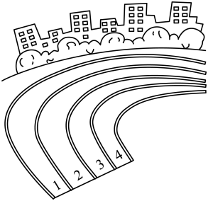

# Mathematics - 题目 2701

**ID**: 484cf45f907549ea90851e10e8dd9fb3
**年级**: Grade 9
**难度**: Easy
**题型**: Calculation

## 题目
甲、乙、丙、丁四名选手参加赛跑，赛场共设1、2、3、4四条跑道，选手以随机抽签方式决定各自的跑道，请用画树状图或列表的方法，求甲、丙两位选手抽中相邻跑道的概率．​​​​​​​‌

## 解答

1. 解：列表如下：
2. 丙
3. 甲
4. 1
5. 2
6. 3
7. 4
8. 1
9. —
10. 12
11. 13
12. 14
13. 2
14. 21
15. —
16. 23
17. 24
18. 3
19. 31
20. 32
21. —
22. 34
23. 4
24. 41
25. 42
26. 43
27. —
28. $\therefore $ 由表格可知，共有 $12$ 中等可能的结果，其中，甲、丙两位选手抽中相邻跑道的结果有 $6$ 种，
29. $\therefore P$ （甲、丙两位选手抽中相邻跑道） $=\frac {6}{12}=\frac {1}{2}$ ．

## 知识点

**中文**:
  - 列表法或树状图法求概率

**English**:
  - Table or Tree Diagram Method

---
