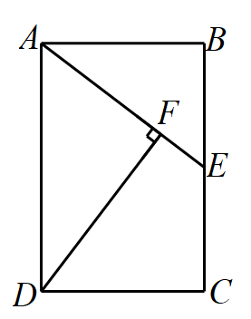

# Mathematics - 题目 688

**ID**: 4e207f57e73041bc9f2c447ed73e90e2
**年级**: Grade 9
**难度**: Easy
**题型**: Calculation

## 题目
如图，在矩形 $ABCD$ 中，点E是边 $BC$ 的中点， $DF\bot AE$ 于点F．(1)求证： $△ADF∽△EAB$ ．(2)已知 $AB=4$ ， $BC=6$ ，求 $EF$ 的长．​​​​​​​‌

## 解答

1. （1）证明：∵四边形 $ABCD$ 为矩形， $DF\bot AE$ ，
2. ∴ $\angle B=\angle AFD=90{}^\circ $ ， $\angle BAE+\angle EAD=\angle EAD+\angle ADF=90{}^\circ $ ，
3. ∴ $\angle BAE=\angle ADF$ ，
4. ∴ $△ADF∽△EAB$ ；
5. （2）解：∵E为 $BC$ 的中点，
6. ∴ $BE=\frac {1}{2}BC=3$ ，
7. ∴ $AE=\sqrt {AB{^{2}}+BE{^{2}}}=5$ ，
8. ∵ $△ADF∽△EAB$ ，
9. ∴ $\frac {AF}{BE}=\frac {AD}{AE}$ ，
10. ∴ $\frac {AF}{3}=\frac {6}{5}$ ，
11. ∴ $AF=3.6$ ，
12. ∴ $EF=AE-AF=5-3.6=1.4$ ．

## 知识点

**中文**:
  - 勾股定理
  - 矩形的性质
  - 相似三角形的判定与性质综合

**English**:
  - Pythagorean Theorem
  - Properties of Rectangles
  - Determination and Properties

---
