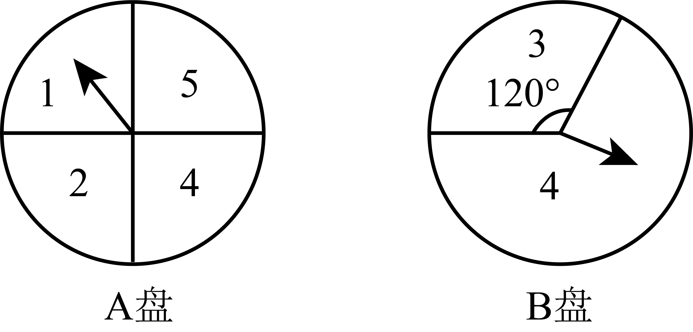

# Mathematics - 题目 2577

**ID**: 51aa48de70134334bc0dd5d496b1f67e
**年级**: Grade 9
**难度**: Easy
**题型**: Calculation

## 题目
如图，小明和小春制作了两个质地均匀、可以自由转动的转盘，A盘被等分为四个扇形，上面分别标有数字1，2，4，5；​​​​​​​‌B盘中圆心角为 $120{}\degree $ 的扇形上面标有数字3，其余部分上面标有数字 $4．$如图，是两个质地均匀、可以自由转动的转盘，A盘被等分为四个扇形，上面分别标（1）小明转动一次A盘，指针指向数字为2的概率是_；（2）小明和小春用如图所示的两个转盘做游戏，游戏规则如下：分别旋转两个转盘，将A盘转出的数字作为被减数，B盘转出的数字作为减数；如果差为正数，则小春胜；若差为负数，则小明胜．这个游戏对双方公平吗？请用列表或画树状图的方法说明你的理由．

## 解答

1. （1）解：小明转动一次A盘，则指针指向数字为2的概率是 $\frac {1}{4}．$
2. （2）解：这个游戏对双方不公平，
3. 理由如下：列表如下：
4. 被减数
5. 减数
6. 1
7. 2
8. 4
9. 5
10. 3
11. $-2$
12. $-1$
13. 1
14. 2
15. 4
16. $-3$
17. $-2$
18. 0
19. 1
20. 4
21. $-3$
22. $-2$
23. 0
24. 1
25. 由表知，共有12种等可能结果，其中差为负数的有6种结果，差为正数的有4种结果，
26. 则小明胜的概率是 $\frac {6}{12}=\frac {1}{2}$ ，小春胜的概率是 $\frac {4}{12}=\frac {1}{3}$ ，
27. $\because \frac {1}{2}>\frac {1}{3}$ ，
28. $\therefore $ 这个游戏对双方不公平．

## 知识点

**中文**:
  - 列表法或树状图法求概率
  - 简单的概率计算
  - 游戏的公平性

**English**:
  - Table or Tree Diagram Method
  - Simple Probability Calculations
  - Fairness of Games

---
