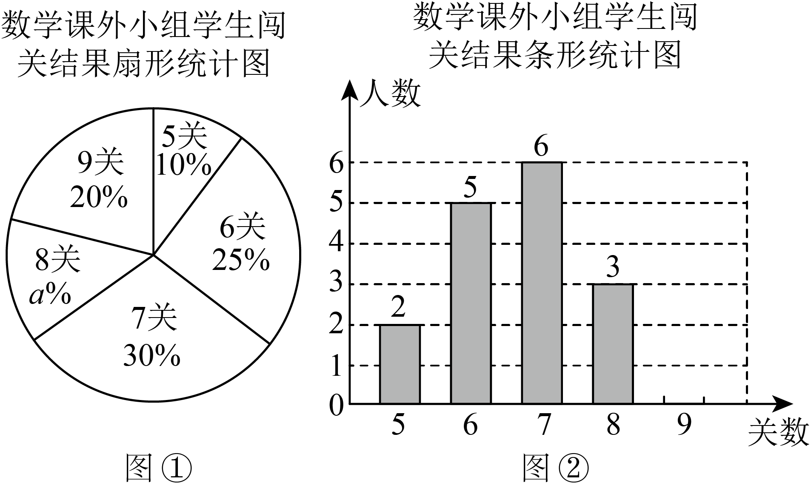

# Mathematics - 题目 981

**ID**: 71b4c4d7f1fa44e5ab5c4acaf75297c9
**年级**: Grade 9
**难度**: Easy
**题型**: Calculation

## 题目
某数学课外小组开展数学“闯关”游戏（游戏一共10关），根据活动结果绘制成如图所示的两幅尚不完整的统计图．（1）数学课外小组的总人数为人， $a=$，请补充完整条形统计图；​​​​​​​‌（2）写出闯关结果的众数；（3）再加入 $n$ 名同学闯关，已知这 $n$ 名同学的闯关结果均大于7关，若这 $n$ 名同学加入后闯关结果的中位数与原闯关结果的中位数相等，则 $n$ 最多是名．

## 解答

1. （1）解： $2\div 10\%=20$ （人），
2. 即数学课外小组的总人数为 $20$ 人，
3. $\frac {3}{20}\times 100\%=15\%$ ，
4. 即 $a=15$ ，
5. 9关的人数为 $20\times 20\%=4$ （人），补全条形统计图如下：
6. 
7. （2）闯关结果数最多的是7关，共6人，故闯关结果的众数为7关；
8. （3）原闯关成绩分别为：5，5，6，6，6，6，6，7，7，7，7，7，7，8，8，8，9，9，9，9，中位数为 $\frac {7+7}{2}=7$ ，
9. 再新加入 $n$ 名同学闯关后，若中位数仍然为7，需最右侧的7排第13位，
10. $\frac {20+n+1}{2}=13$
11. $n=5$
12. 这时 $n$ 取最大值为5．

## 知识点

**中文**:
  - 中位数
  - 众数
  - 条形统计图

**English**:
  - Median
  - Mode
  - Bar Charts

---
