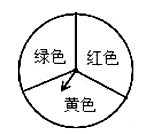

# Mathematics - 题目 751

**ID**: 7e1ef10cd0c34cd091956e3adf14629c
**年级**: Grade 9
**难度**: Easy
**题型**: Calculation

## 题目
甲、乙两位同学玩转盘游戏，游戏规则：将圆盘平均分成三份，分别涂上红，黄，绿三种颜色，两位同学分别转动转盘两次(若压线，重新转)．若两次指针指到的颜色相同，则甲获胜；​​​​​​​‌若两次指针指到的颜色是黄绿组合则乙获胜；其余情况则视为平局．（1）请用画树状图或列表的方法，写出所有可能出现的结果；（2）试用概率说明游戏是否公平．

## 解答

1. （1）树状图，如图所示：
2. 
3. (红，红)，(红，黄)，(红，绿)，(黄，红)，(黄，黄)，(黄，绿)，(绿，红)，(绿，黄)，(绿，绿) 共9种情况；
4. （2） $P{{}_{(甲获胜)}}=\frac {3}{9}=\frac {1}{3}$
5. $P{{}_{(乙获胜)}}=\frac {2}{9}$
6. $P{{}_{(甲获胜)}}>P{{}_{(乙获胜)}}$
7. 所以游戏不公平．

## 知识点

**中文**:
  - 列表法或树状图法求概率
  - 游戏的公平性

**English**:
  - Table or Tree Diagram Method
  - Fairness of Games

---
