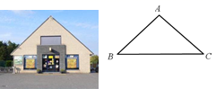

# Mathematics - 题目 1422

**ID**: 849bed1139874e68bd4001b8444de1b8
**年级**: Grade 9
**难度**: Easy
**题型**: Calculation

## 题目
等腰三角形的屋顶，是建筑中经常采用的结构形式．在如图所示的等腰三角形屋顶ABC中，AB=AC，测得BC=20米，∠C=41°，求顶点A到BC边的距离是多少米？（结果精确到0.​​​​​​​‌1米．参考数据：sin41°≈0.656，cos41°≈0.755，tan41°≈0.869．）

## 解答

1. 解：作AD⊥BC，垂足为D点
2. 
3. ∵AB=AC， AD⊥BC，BC=20
4. ∴BD=CD= $\frac {1}{{\rm{2}}}$ BC=10．
5. 在Rt△ACD中，∠C=41°，
6. ∴tan C=tan41°= $\frac {AD}{CD}$ ，
7. ∴AD= $CD\cdot {\tan}41{}^\circ $ ≈10×0.869 ≈8.7．
8. 答：顶点A到BC边的距离是8.7米．

## 知识点

**中文**:
  - 等腰三角形的性质
  - 解直角三角形的实际应用

**English**:
  - Properties of Isosceles Triangles
  - Applications of Solving Right Triangles

---
