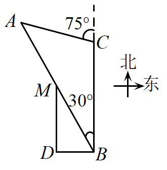

# Mathematics - 题目 970

**ID**: 87bd6a85be134710a275df30444cf9e0
**年级**: Grade 9
**难度**: Easy
**题型**: Calculation

## 题目
五一节期间，小融和小墩相约去动物园 $A$ 玩，小融家 $C$ 在小墩家 $B$ 正北方向，动物园 $A$ 在小墩家 $B$ 的北偏西 $30{}^\circ $ 方向上、在小融家 $C$ 的北偏西 $75{}^\circ $ 方向上，在小墩家的正西方向有一个便利店 $D$ 正好在 $AB$ 的中点 $M$ 的正南方．已知动物园 $A$ 与小融家 $C$ 相聚 $8{\rm{k}}{\rm{m}}$ ．（结果精确到十分位，参考数据： $\sqrt {3}=1.​​​​​​​‌73$ ， $\sqrt {2}\approx 1.41$ ， $\sqrt {6}\approx 2.45$ ）(1)求小墩家 $B$ 与小融家 $C$ 距离为多少千米？(2)若图中的B$C$ 、 $CA$ 、 $BA$ 、 $BD$ 、 $DM$ 都是同一平面内的健身步道， 因 $BM$ 段在施工无法通行，小墩到公园 $A$ 可以走路线 $B\to C\to A$ ，也可以走路线 $B\to D\to M\to A$  ，请经过计算说明他走哪一条路线较近？

## 解答

1. （1）
2. 解：过点C作 $CH\bot AB$ 于H， $\angle A=75{}^\circ -30{}^\circ =45{}^\circ $ ，
3. ∴ $CH=AC\cdot {\sin}45{}^\circ =4\sqrt {2}$ ，
4. ∴ $BC=\frac {CH}{{\sin}30{}^\circ }=8\sqrt {2}\approx 11.{\rm{3}}{\rm{k}}{\rm{m}}$ ．
5. （2）由（1）得 $AH=CH=4\sqrt {2}$ ， $BH=\frac {CH}{{\tan}30{}^\circ }=4\sqrt {6}$ ，
6. $AB=AH+HB=4\sqrt {2}+4\sqrt {6}$ ，
7. ∴ $AM=BM=2\sqrt {2}+2\sqrt {6}$ ，
8. ∴ $BD=BM\cdot {\sin}30{}^\circ =\sqrt {2}+\sqrt {6}$ ， $MD=BM\cdot {\cos}30{}^\circ =\sqrt {6}+3\sqrt {2}$ ，
9. ∴ $AC+BC=8+8\sqrt {2}\approx {\rm{1}}{\rm{9}}{\rm{.}}{\rm{3}}{\rm{k}}{\rm{m}}$ ， $BD+MD+MA=6\sqrt {2}+4\sqrt {6}\approx {\rm{1}}{\rm{8}}{\rm{.}}{\rm{3}}{\rm{k}}{\rm{m}}$ ，
10. $18.3<19.3$ ．
11. 答：路线 $B\to D\to M\to A$ 路线更近．

## 知识点

**中文**:
  - 解直角三角形的实际应用

**English**:
  - Applications of Solving Right Triangles

---
