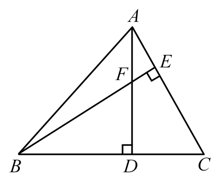

# Mathematics - 题目 3575

**ID**: 8e4ce62b4fea4043ad9179d0884e9ade
**年级**: Grade 9
**难度**: Easy
**题型**: Calculation

## 题目
如图，在 $\vartriangle ABC$ 中， $AD\bot BC,BE\bot AC$ ，垂足分别为 $D,E,AD$ 与 $BE$ 交于点 $F$ ．请你在图中找出4对相似三角形（不需要写出证明过程）．​​​​​​​‌

## 解答

1. 解：∵ $AD\bot BC,BE\bot AC$ ，
2. ∴ $\angle AEF=\angle BEC=\angle ADC=\angle ADB=90{}\degree $ ，
3. ∵ $\angle DAC=\angle FAE$ ，
4. ∴ $\mathrm{△}AEF∽\mathrm{△}ADC$ ，
5. ∵ $\angle AFE=\angle BFD$ ，
6. ∴ $\vartriangle BDF∽\vartriangle AEF$ ，
7. ∴ $\angle DAC=\angle DBF$ ，
8. ∴ $\vartriangle BDF∽\vartriangle ADC$ ， $\vartriangle ADC∽\vartriangle BEC$ ，
9. ∴ $\mathrm{△}BDF\mathrm{∽}\mathrm{△}BEC$ ．

## 知识点

**中文**:
  - 相似三角形的判定

**English**:
  - Determination of Similar Triangles

---
