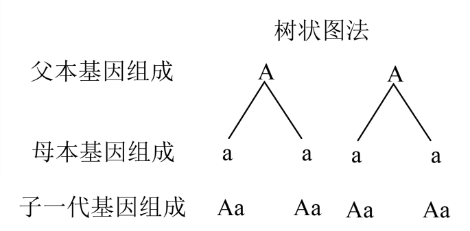

# Mathematics - 题目 1645

**ID**: 96bc7710e9e642a0b1ff45be63f55cc5
**年级**: Grade 9
**难度**: Easy
**题型**: Calculation

## 题目
樱桃番茄又称圣女果，果皮颜色有红、黄色之分，因维生素含量高而广受喜爱．某农科所希望通过杂交育种的方式培育需要的圣女果品种．【知识理解】根据遗传学知识，红色果皮圣女果的基因组成是 ${\rm{A}}{\rm{A}}$ 或 ${\rm{A}}{\rm{a}}$ ，黄色果皮圣女果的基因组成是 ${\rm{a}}{\rm{a}}$ ．若将一株红色果皮圣女果 $\left ({{\rm{A}}{\rm{A}}}\right )$ 作为父本，与一株黄色果皮圣女果 $\left ({{\rm{a}}{\rm{a}}}\right )$ 作为母本进行杂交，我们可以通过列表法或树状图法表示子一代圣女果的基因组成．列表法父本基因组成母本基因组成AAaAaAaaAaAa【知识应用】(1)若实验员将一株红色果皮圣女果 $\left ({{\rm{A}}{\rm{a}}}\right )$ 与一株黄色果皮圣女果 $\left ({{\rm{a}}{\rm{a}}}\right )$ 进行杂交，请通过列表法或树状图法，求子一代圣女果是红色果皮的概率．(2)农科所计划扩大圣女果杂交规模．将基因组成 $\left ({{\rm{A}}{\rm{a}}}\right )$ 与基因组成 $\left ({{\rm{a}}{\rm{a}}}\right )$ 的圣女果进行杂交（排除其他因素干扰），培育得到5000株后代，请估计圣女果是红色果皮的有多少株？​​​​​​​‌

## 解答

1. （1）解：利用树状图求概率如下：
2. 
3. 由图可知，子一代的基因组成结果共有4种，这些结果出现的可能性相等，恰好是红色果皮的结果有2种，
4. $\therefore P{{}_{(红色果皮)}}=\frac {2}{4}=\frac {1}{2}$ ．
5. （2）解：由（1）可知，基因组成 $\left ({{\rm{A}}{\rm{a}}}\right )$ 与基因组成 $\left ({{\rm{a}}{\rm{a}}}\right )$ 的圣女果进行杂交，后代是红色果皮的概率为 $\frac {1}{2}$ ．
6. $\therefore $ 红色果皮的有 $5000\times \frac {1}{2}=2500$ （株）．
7. 答：估计是红色果皮的有2500株．

## 知识点

**中文**:
  - 列表法或树状图法求概率

**English**:
  - Table or Tree Diagram Method

---
