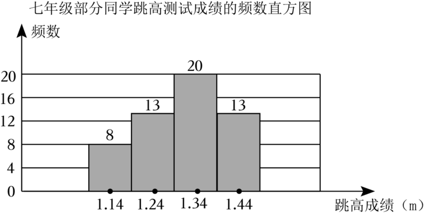

# Mathematics - 题目 1406

**ID**: a3ebdb7098cc452681c101535dcb7bc9
**年级**: Grade 9
**难度**: Easy
**题型**: Calculation

## 题目
随机抽取某校七年级部分同学的跳高测试成绩，得到如下频数分布直方图（每组含前一个边界值，不含后一个边界值）．(1)该组数据中，中位数所在组的频数是多少？请写出该组的边界值．(2)若该校七年级总共有360名学生，那么跳高成绩在1.​​​​​​​‌29m（含1.29m）以上的大约有多少人？

## 解答

1. （1）解：参加测试的总人数为 $8+13+20+13=54$ （人 $)$ ，
2. 把这54人的成绩从小到大排列，排在中间的两个数落在 $1.34{\rm{m}}$ 这一组，
3. 故中位数所在组的频数是20；
4. 组距为 $1.24-1.14=0.10({\rm{m}})$ ，
5. $\therefore 1.34{\rm{m}}$ 这一组的边界值是 $1.29\sim 1.39$ ；
6. （2）解： $360\times \frac {20+13}{54}=220$ （人），
7. 答：跳高成绩在1.29m（含1.29m）以上的大约有220人．

## 知识点

**中文**:
  - 频数分布直方图

**English**:
  - Frequency Histograms

---
