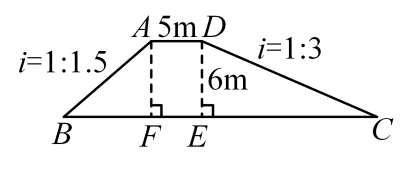

# Mathematics - 题目 2813

**ID**: b101e7dd589b4619b7a92f25cb1f8432
**年级**: Grade 9
**难度**: Easy
**题型**: Calculation

## 题目
如图，拦水坝的横断面为梯形 $ABCD$ ，斜面 $AB$ 的坡度 $i=1:1.​​​​​​​‌5$ ，斜面 $CD$ 的坡度 $i=1:3$ ，根据图中数据，求：(1)斜坡 $AB$ 的长（结果保留小数点后一位）；(2)梯形 $ABCD$ 的周长（结果保留小数点后一位）．（参考数据： $\sqrt {3}\approx 1.73$ ， $\sqrt {10}\approx 3.16$ ， $\sqrt {13}\approx 3.61$ ）

## 解答

1. （1）解： $\because $ 斜面 $AB$ 的坡度 $i=1:1.5$ ， $AF=DE=6{\rm{m}}$ ，
2. $\therefore AF:BF=1:1.5$ ，
3. $\therefore 6:BF=1:1.5$ ，
4. $\therefore BF=9{\rm{m}}$ ，
5. $\therefore AB=\sqrt {6{^{2}}+9{^{2}}}=3\sqrt {13}\approx 10.8\left ({{\rm{m}}}\right )$ ，
6. 答：斜坡 $AB$ 的长约为 $10.8{\rm{m}}$ ；
7. （2）解： $\because $ 斜面 $CD$ 的坡度 $i=1:3$ ， $DE=6{\rm{m}}$ ，
8. $\therefore DE:EC=1:3$ ，
9. 解得 $EC=18{\rm{m}}$ ，
10. $\therefore DC=\sqrt {6{^{2}}+18{^{2}}}=6\sqrt {10}\approx 18.96\left ({{\rm{m}}}\right )$ ，
11. $\therefore $ 梯形 $ABCD$ 的周长为 $AB+AD+DC+BC\approx 10.83+18.96+5+9+5+18\approx 66.8\left ({{\rm{m}}}\right )$ ，
12. 答：梯形 $ABCD$ 的周长为 $66.8{\rm{m}}$ ．

## 知识点

**中文**:
  - 勾股定理
  - 解直角三角形的实际应用

**English**:
  - Pythagorean Theorem
  - Applications of Solving Right Triangles

---
