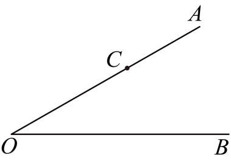

# Mathematics - 题目 3491

**ID**: e33c9b58a95644de8a901e0d10bd8c69
**年级**: Grade 9
**难度**: Easy
**题型**: Calculation

## 题目
如图，已知 $∠AOB$ ，点C在射线 $OA$ 上．若 $\angle AOB=30{}\degree $ ，请用尺规作图法，在射线 $OB$ 上求作两点P，Q，使 $\vartriangle CPQ$ 为等边三角形．（保留作图痕迹，不写作法）​​​​​​​‌

## 解答

1. 解：如图， $\vartriangle CPQ$ 即为所求作：
2. 

## 知识点

**中文**:
  - 尺规作图——作线段垂直平分线
  - 等边三角形的判定
  - 线段垂直平分线的性质

**English**:
  - Construction: Perpendicular Bisector
  - Determination of Equilateral Triangles
  - Properties of Perpendicular Bisectors

---
