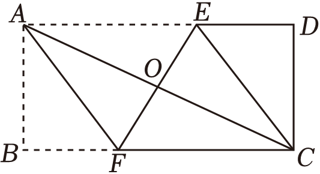

# Mathematics - 题目 1413

**ID**: e6a4db243d9c460aaf9ef98aeafd3ed5
**年级**: Grade 9
**难度**: Easy
**题型**: Calculation

## 题目
如图，点E，F分别是矩形 $ABCD$ 的边 $AD$ ，将矩形 $ABCD$ 沿直线 $EF$ 对折后，点A与点C重合，求证：四边形 $AECF$ 为菱形．​​​​​​​‌

## 解答

1. 证明：∵将矩形 $ABCD$ 沿直线 $EF$ 对折后，点A与点C重合，
2. ∴ $OA=OC$ ， $EF⊥AC$ ，
3. ∵四边形 $ABCD$ 为矩形，
4. ∴ $AD{\rm{/\mskip-4mu/}}BC$ ，
5. ∴ $\angle OAE=\angle OCF$ ， $\angle OEA=\angle OFC$ ，
6. 在 $\mathrm{△}OAE$ 和 $\mathrm{△}OCF$ 中，
7. $\begin{cases}\angle OEA=\angle OFC\\\angle OAE=\angle OCF\\OA=OC\end{cases}$ ，
8. ∴ $\mathrm{△}OAE{\rm{≌}}\mathrm{△}OCF\left ({{\rm{A}}{\rm{A}}{\rm{S}}}\right )$ ，
9. ∴ $OE=OF$ ，
10. ∵ $OA=OC$ ， $EF⊥AC$ ，
11. ∴四边形 $AECF$ 为菱形．

## 知识点

**中文**:
  - 全等三角形的判定与性质
  - 菱形的判定
  - 矩形的性质
  - 折叠问题

**English**:
  - Determination and Properties
  - Determination of Rhombuses
  - Properties of Rectangles
  - Folding Problems

---
