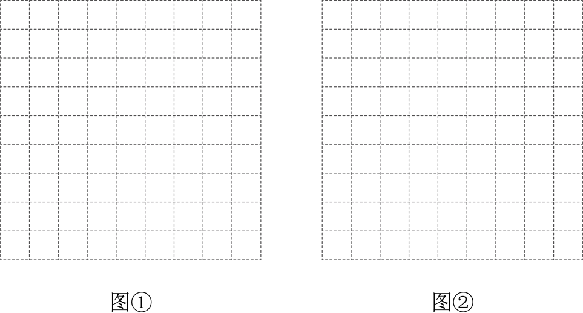

# Mathematics - 题目 937

**ID**: f3284b9df99449baa6626222c94d7f88
**年级**: Grade 9
**难度**: Easy
**题型**: Calculation

## 题目
如图①，图②，在 $9\times 9$ 的正方形网格中，按要求画平行四边形，使每个图形同时满足下列条件：（1）它的四个顶点以及对角线交点都在格点上；​​​​​​​‌（2）所画的图形的周长是整数；（3）两个图形不全等．

## 解答

1. 解：如图， $▱ABCD$ 和 $▱EFGH$ 为所求作的平行四边形．
2. 

## 知识点

**中文**:
  - 平行四边形的对边平行且相等

**English**:
  - Opposite Sides Parallel and Equal

---
