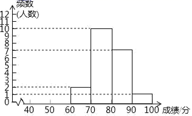

# Mathematics - 题目 767

**ID**: f4a808805a0f40c2b833ddee0d032aa2
**年级**: Grade 9
**难度**: Easy
**题型**: Calculation

## 题目
为了推动全社会自觉尊法学法守法用法，促进全面依法治国，某区每年都举办普法知识竞赛，该区某单位甲、乙两个部门各有员工200人，要在这两个部门中挑选一个部门代表单位参加今年的竞赛，为了解这两个部门员工对法律知识的掌握情况，进行了抽样调查，从甲、乙两个部门各随机抽取20名员工，进行了法律知识测试，获得了他们的成绩（百分制），并对数据（成绩）进行整理，描述和分析，下面给出了部分信息．a．甲部门成绩的频数分布直方图如下（数据分成6组：40⩽x＜50，50⩽x＜60，60⩽x＜70，70⩽x＜80，80⩽x＜90，90⩽x⩽100）b．乙部门成绩如下：40  52   70  70   71   73  77  78   80   8182  82  82   82   83   83  83   86  91   94c．甲、乙两部门成绩的平均数、方差、中位数如下：平均数方差中位数甲79.​​​​​​​‌636.8478.5乙77147.2md．近五年该单位参赛员工进入复赛的出线成绩如下：2014年2015年2016年2017年2018年出线成绩（百分制）7981808182根据以上信息，回答下列问题：（1）写出表中m的值；（2）可以推断出选择部门参赛更好，理由为；（3）预估（2）中部门今年参赛进入复赛的人数为．

## 解答

1. 解：（1）将乙组成绩的中位数m＝ $\frac {81+82}{2}$ ＝81.5；
2. （2）可以推断出选择甲部门参赛更好，理由为甲的平均成绩高，且方差小，成绩稳定；
3. 故答案为甲，甲的平均成绩高，且方差小，成绩稳定．
4. （3）预估（2）中部门今年参赛进入复赛的人数为200× $\frac {7+1}{20}$ ＝80（人），
5. 故答案为80人．

## 知识点

**中文**:
  - 中位数
  - 用样本估计总体
  - 频数分布直方图
  - 算术平均数
  - 方差

**English**:
  - Median
  - Estimating Population from Sample
  - Frequency Histograms
  - Arithmetic Mean
  - Variance

---
