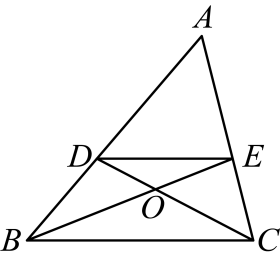

# Mathematics - 题目 3639

**ID**: 0050ef627b7645ee831ba6d55fdb5fce
**年级**: Grade 9
**难度**: Easy
**题型**: Fill-in-the-blank

## 题目
如图，已知 $DE\mathbf{/\mskip-4mu/}BC$ ， $CD$ 和 $BE$ 相交于 $O$ ，若 $S{{}_{\mathrm{△}DOE}}:S{{}_{\mathrm{△}COB}}=9:25$ ，则 $AD:DB=$．​​​​​​​‌

## 解答

1. 解： $\because DE\mathrm{/\mskip-4mu/}BC$ ，
2. ∴ $\angle ADE=\angle ABC,\angle AED=\angle ACB$ ， $\angle CDE=\angle BCD,\angle DEB=\angle CBE$ ，
3. $\therefore \mathrm{△}ADE\mathrm{∽}\mathrm{△}ABC$ ， $△DOE∽△COB$ ，
4. $\because S{{}_{\vartriangle DOE}}:S{{}_{\vartriangle COB}}=9:25$ ，
5. $\therefore $  $\frac {DE}{BC}=\frac {3}{5}$ ，
6. ∴ $\frac {AD}{AB}=\frac {DE}{BC}=\frac {3}{5}$ ，
7. $\therefore $  $\frac {AD}{AB}=\frac {3}{2}$ ，
8. $\therefore AD:DB=3:2$ ．

## 知识点

**中文**:
  - 相似三角形的判定与性质综合

**English**:
  - Determination and Properties

---
