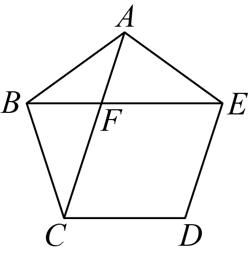

# Mathematics - 题目 2134

**ID**: 05fe236ad2094469a89a3fe061a5d65a
**年级**: Grade 9
**难度**: Easy
**题型**: Fill-in-the-blank

## 题目
如图，在正五边形 $ABCDE$ 中，连接 $AC{\rm{，}}BE$ 交于点F，则 $\angle AFB$ 的度数为．​​​​​​​‌

## 解答

1. 解：∵五边形 $ABCDE$ 为正五边形，
2. ∴ $AB=BC=AE,\angle ABC=\angle BAE=\frac {\left ({5-2}\right )\times 180{}\degree }{5}=108{}\degree $ ，
3. ∴ $\angle BAC=\angle BCA=\angle ABE=\angle AEB=\left ({180{}\degree -108{}\degree }\right )\div 2=36{}\degree $ ，
4. ∴ $\angle AFB=180{}\degree -\left ({\angle ABF+\angle BAF}\right )=180{}\degree -36{}\degree -36{}\degree =108{}\degree $ ．

## 知识点

**中文**:
  - 多边形的内角

**English**:
  - Interior Angles of Polygons

---
