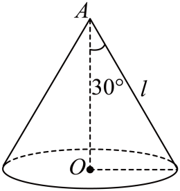

# Mathematics - 题目 625

**ID**: 09ccf01340a149018eff9b7903da7a07
**年级**: Grade 9
**难度**: Easy
**题型**: Fill-in-the-blank

## 题目
如图，圆锥的底面圆心为 $O$ ，顶点为 $A$ ，母线 $l$ 长为 $4$ ，母线 $l$ 与高 $AO$ 的夹角为 $30{}\degree $ ，那么圆锥侧面展开图的面积为．​​​​​​​‌

## 解答

1. 解：如图，
2. 
3. 由题意得， $\angle BAO=30{}\degree $ ， $\angle AOB=90{}\degree $ ，
4. ∴ $OB=\frac {1}{2}AB=2$ ，
5. ∴圆锥侧面展开图的面积为 ${\rm{π}}\times OB\times l={\rm{π}}\times 2\times 4=8{\rm{π}}$ ，
6. 故此题答案为 $8{\rm{π}}$ ．

## 知识点

**中文**:
  - 圆锥的侧面积计算

**English**:
  - Cone Lateral Area Calculation

---
