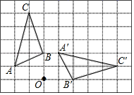

# Mathematics - 题目 1494

**ID**: 183faa39e9e343b7b8658cebee0dd43b
**年级**: Grade 9
**难度**: Easy
**题型**: Fill-in-the-blank

## 题目
在如图所示的方格纸(1格长为1个单位长度)中，△ABC的顶点都在格点上，将△ABC绕点O按顺时针方向旋转得到△A'B'C'，使各顶点仍在格点上，则其旋转角的度数是．．​​​​​​​‌

## 解答

1. 根据旋转角的概念：对应点与旋转中心连线的夹角，可知∠BOB′是旋转角，且∠BOB′＝90°，
2. 故答案为90°．

## 知识点

**中文**:
  - 旋转的性质

**English**:
  - Properties of Rotation

---
