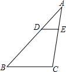

# Mathematics - 题目 3721

**ID**: 2fafef99a5a9422eaeb74e07dfb3e5bc
**年级**: Grade 9
**难度**: Easy
**题型**: Fill-in-the-blank

## 题目
如图，在△ABC中，点D、E分别在AB、AC上，且DE∥BC，已知AD＝2，DB＝4，DE＝1，则BC＝．​​​​​​​‌

## 解答

1. 解：∵DE∥BC，
2. ∴△ADE∽△ABC，
3. ∴DE：BC＝AD：AB，
4. ∵AD＝2，DB＝4，
5. ∴AB＝AD+BD＝6，
6. ∴1：BC＝2：6，
7. ∴BC＝3，
8. 故答案为3．

## 知识点

**中文**:
  - 相似三角形的判定与性质综合

**English**:
  - Determination and Properties

---
