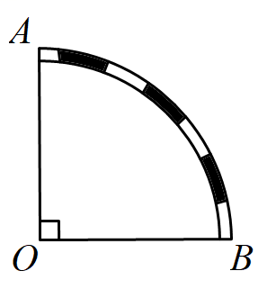

# Mathematics - 题目 1233

**ID**: 3af27d966e3a476ab4cbd6316290e8f7
**年级**: Grade 9
**难度**: Easy
**题型**: Fill-in-the-blank

## 题目
如图是圆弧形状的铁轨示意图，半径OA的长度为200米，圆心角 $\angle AOB=90{}\degree $ ，则这段铁轨的长度米，（铁轨的宽度忽略不计，结果保留π）​​​​​​​‌

## 解答

1. 解：由题意可知，铁轨的长度为劣弧AB的长度 $=\frac {nπr}{180{^{\circ }}}=\frac {90{^{\circ }}}{180{^{\circ }}}\times π\times 200=100π$

## 知识点

**中文**:
  - 弧长公式

**English**:
  - Arc Length Formula

---
