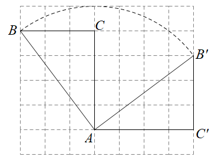

# Mathematics - 题目 2008

**ID**: 53ddfbb2a5f24affbe269d70e11312c6
**年级**: Grade 9
**难度**: Easy
**题型**: Fill-in-the-blank

## 题目
如图，点 $A$ ， $B$ ， $C$ 都在方格纸的格点上， $\vartriangle ABC$ 绕点 $A$ 顺时针方向旋转 $90{}^\circ $ 后得到 $\vartriangle AB^{′}C^{′}$ ，则点 $B$ 运动的路径 $\overset ⌢{{BB^{′}}}$ 的长为．​​​​​​​‌

## 解答

1. 由题意得，AC=4，BC=3，
2. ∴ $AB=\sqrt {AC{^{2}}+BC{^{2}}}=\sqrt {4{^{2}}+3{^{2}}}=5$ ,
3. ∵ $\vartriangle ABC$ 绕点 $A$ 顺时针方向旋转 $90{}^\circ $ 后得到 $\vartriangle AB^{′}C^{′}$ ，
4. ∴ $\angle BAB^{′}=90{}^\circ $ ,
5. ∴ $\overset ⌢{{BB^{′}}}$ 的长为： $l=\frac {90{}^\circ π\centerdot 5}{180{}^\circ }=\frac {5}{2}π$ ，
6. 故答案为： $\frac {5}{2}π$ ．

## 知识点

**中文**:
  - 勾股定理
  - 弧长公式
  - 旋转的性质

**English**:
  - Pythagorean Theorem
  - Arc Length Formula
  - Properties of Rotation

---
