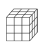

# Mathematics - 题目 150

**ID**: 5a4239e1b8e24dd0adf09a23e9ac4241
**年级**: Grade 9
**难度**: Easy
**题型**: Fill-in-the-blank

## 题目
将一个所有的面都涂上漆的正方体（如图所示）切开，使之成为27个大小相同的小正方体，那么只有两面涂漆的小正方体有个．​​​​​​​‌

## 解答

1. 
2. ∴只有两面涂漆的小正方体有12个．
3. 故答案为：12．

## 知识点

**中文**:
  - 几何体的展开图
  - 认识立体图形

**English**:
  - Nets of Geometric Solids
  - Recognizing Solid Figures

---
