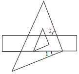

# Mathematics - 题目 3414

**ID**: 5e7e1239ceb54165b4a092a3abc9c2d1
**年级**: Grade 9
**难度**: Easy
**题型**: Fill-in-the-blank

## 题目
如图，将直尺与三角尺叠放在一起，如果 $\mathrm{∠}2=62\mathrm{°}$ ，那么 $\angle 1$ 的度数为．​​​​​​​‌

## 解答

1. ∵将直尺与三角尺叠放在一起，
2. ∴AB//CD，∠EOF=90°，
3. ∴∠2=∠3，
4. ∵∠1+∠3=∠EOF=90°， $\mathrm{∠}2=62\mathrm{°}$ ，
5. ∴∠1=90°-62°=28°，
6. 
7. 故答案为：28°

## 知识点

**中文**:
  - 两直线平行同位角相等

**English**:
  - Parallel Lines have Equal Corresponding Angles

---
