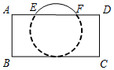

# Mathematics - 题目 1938

**ID**: 86cbfabcf6f540e58edd6c3bb4965dbf
**年级**: Grade 9
**难度**: Easy
**题型**: Fill-in-the-blank

## 题目
把球放在长方体纸盒内，球的一部分露出盒外，其截面如图所示，已知EF＝CD＝2cm，则球的半径为cm．​​​​​​​‌

## 解答

1. 解：EF的中点M，作MN⊥AD于点M，取MN上的球心O，连接OF，
2. 
3. ∵四边形ABCD是矩形，
4. ∴∠C＝∠D＝90°，
5. ∴四边形CDMN是矩形，
6. ∴MN＝CD＝2
7. 设OF＝x，则ON＝OF，
8. ∴OM＝MN﹣ON＝2﹣x，MF＝1，
9. 在直角三角形OMF中，OM^{2}+MF^{2}＝OF^{2}，
10. 即：（2﹣x）^{2}+1^{2}＝x^{2}，
11. 解得：x＝ $\frac {5}{4}$ ，
12. 故答案为： $\frac {5}{4}$ ．

## 知识点

**中文**:
  - 垂径定理的应用

**English**:
  - Applications of Perpendicular Chord Theorem

---
