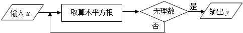

# Mathematics - 题目 3913

**ID**: 8d4f34518b9f462699047e0db0718000
**年级**: Grade 9
**难度**: Easy
**题型**: Fill-in-the-blank

## 题目
有一个数值转换机，原理如下：当输入的 $x=81$ 时，输出的 $y=$．​​​​​​​‌

## 解答

1. 解：当x=81时，算术平方根为9，
2. 再输入9，9的算术平方根为3，
3. 再输入3，3的算术平方根为 $\sqrt {3}$ ，为无理数，
4. 所以 $y=\sqrt {3}$ ，
5. 故答案为： $\sqrt {3}$ ．

## 知识点

**中文**:
  - 算术平方根

**English**:
  - Arithmetic Square Roots

---
