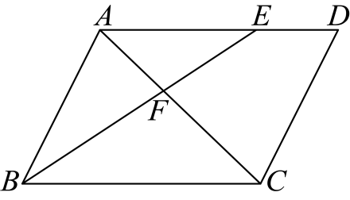

# Mathematics - 题目 738

**ID**: a6e004e1eed8457585dcd728cf4b1c89
**年级**: Grade 9
**难度**: Easy
**题型**: Fill-in-the-blank

## 题目
如图，在平行四边形 $ABCD$ 中，点E为边 $AD$ 的黄金分割点，且 $AE>ED$ ，则 $\frac {CF}{AF}=$．​​​​​​​‌

## 解答

1. 解： $\because $ 点E为边 $AD$ 的黄金分割点，
2. $\therefore \frac {AE}{AD}=\frac {\sqrt {5}-1}{2}$ ，
3. $\because $ 四边形 $ABCD$ 是平行四边形，
4. $∴AD\mathrm{/\mskip-4mu/}BC$ ，
5. $AD=BC$ ，
6. $\therefore \mathrm{△}CBF∽\mathrm{△}AEF$ ，
7. $\therefore \frac {AE}{BC}=\frac {\sqrt {5}-1}{2}$ ，
8. $\therefore \frac {CF}{AF}=\frac {BC}{EA}$
9. $\therefore \frac {CF}{AF}=\frac {2}{\sqrt {5}-1}$
10. $=\frac {\sqrt {5}+1}{2}$ .

## 知识点

**中文**:
  - 相似三角形的判定与性质综合
  - 黄金分割

**English**:
  - Determination and Properties
  - Golden Ratio

---
