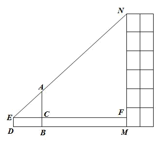

# Mathematics - 题目 961

**ID**: a7dd6ddb54914b7b8f3d1de45a368e04
**年级**: Grade 9
**难度**: Easy
**题型**: Fill-in-the-blank

## 题目
如图，要测量楼高 $MN$ ，在距 $MN$ 为 $15{\rm{m}}$ 的点 $B$ 处坚立一根长为 $5.​​​​​​​‌5{\rm{m}}$ 的直杆 $AB$ ，恰好使得观测点 $E$ 、直杆顶点 $A$ 和高楼顶点 $N$ 在同一条直线上．若 $DB=5{\rm{m}},DE=1.5{\rm{m}}$ ，则楼高 $MN$ 是．

## 解答

1. 解：依题意，四边形 $CBDE,FMDE,FMBC$ 都是矩形，
2. ∴ $FM=CB=ED=1.5{\rm{m}}$ ， $EC=DB=5{\rm{m}}$ ， $FC=BM=15{\rm{m}}$ ，
3. ∵ $AB=5.5{\rm{m}}$ ，
4. ∴ $AC=AB-BC=5.5-1.5=4\left ({{\rm{m}}}\right )$ ,
5. ∵ $AC{\rm{/\mskip-4mu/}}MF$ ，
6. ∴ $\vartriangle AEC∽\vartriangle NEF$ ，
7. ∴ $\frac {AC}{NF}{\rm{=}}\frac {EC}{EF}$ ，
8. 即 $\frac {4}{NF}=\frac {5}{5+15}$ ，
9. 解得： $NF=16{\rm{m}}$ ，
10. ∴ $MN=MF+FN=16+1.5=17.5\left ({{\rm{m}}}\right )$ ，
11. 故答案为： $17.5{\rm{m}}$ ．
12. 【点睛】本题考查了相似三角形的的应用，熟练掌握相似三角形的性质与判定是解题的关键．

## 知识点

**中文**:
  - 解直角三角形的实际应用

**English**:
  - Applications of Solving Right Triangles

---
