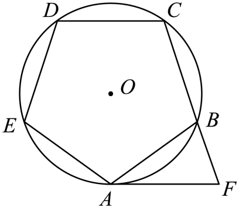

# Mathematics - 题目 351

**ID**: b2176c37424a46e98b5c383f3282dfad
**年级**: Grade 9
**难度**: Easy
**题型**: Fill-in-the-blank

## 题目
如图，正五边形 $ABCDE$ 内接于 $\odot O$ ，过点A的切线与 $CB$ 的延长线相交于点 $F$ ，则 $\angle F=$．​​​​​​​‌

## 解答

1. 解：连接 $OA$ ，如图
2. ∵ $AF$ 与 $\odot O$ 相切
3. ∴ $\angle OAF=90{}\degree $
4. 正五边形 $ABCDE$ 中， $\angle EAB=\angle ABC=\frac {(5-2)\times 180{}\degree }{5}=108{}\degree $
5. ∴ $\angle OAB=\frac {1}{2}\angle EAB=\frac {1}{2}\times 108{}\degree =54{}\degree $
6. ∴ $\angle BAF=\angle OAF-\angle OAB=90{}\degree -54{}\degree =36{}\degree $
7. ∵ $\angle ABC=\angle BAF+\angle F$
8. ∴ $\angle F=\angle ABC-\angle BAF=108{}\degree -36{}\degree =72{}\degree $
9. 

## 知识点

**中文**:
  - 切线的性质定理
  - 多边形的内角

**English**:
  - Tangent Properties Theorem
  - Interior Angles of Polygons

---
