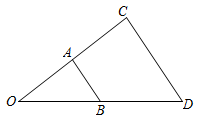

# Mathematics - 题目 1807

**ID**: b36e9d25907a4047bd10b981a46c9c42
**年级**: Grade 9
**难度**: Easy
**题型**: Fill-in-the-blank

## 题目
如图，△AOB与 ${\rm △\mathit{COD}}$ 是位似图形，且OA＝AC，则 $\vartriangle AOB$ 与 $△COD$ 的相似比为．​​​​​​​‌

## 解答

1. 解：∵OA＝AC，
2. ∴ $\frac {OA}{OC}=\frac {1}{2}$ ，
3. ∵ ${\rm △\mathit{AOB}}$ 与 ${\rm △\mathit{COD}}$ 是位似图形，
4. ∴ ${\rm △\mathit{AOB}∽△\mathit{COD}}$ ，
5. ∴ $\vartriangle AOB$ 与 $△COD$ 的相似比为 $\frac {1}{2}$ ．

## 知识点

**中文**:
  - 位似图形
  - 相似三角形的判定与性质综合

**English**:
  - Homothetic Figures
  - Determination and Properties

---
