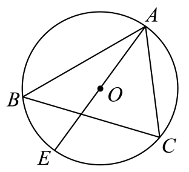

# Mathematics - 题目 1979

**ID**: b677d513c4b5428fb5d8ed76df54079b
**年级**: Grade 9
**难度**: Easy
**题型**: Fill-in-the-blank

## 题目
如图，已知 $\odot O$ 的直径 $AE=10{\rm{c}}{\rm{m}}$ ， $\angle B=\angle EAC$ ，则 $AC$ 的长为$cm$ ．​​​​​​​‌

## 解答

1. 解：如图所示，连接 $CE$ ，
2. 
3. ∵ $\overset{\frown}{{AC}}=\overset{\frown}{{AC}}$ ，
4. ∴ $\angle B=\angle E$ ，
5. ∵ $\angle B=\angle EAC$ ，
6. ∴ $\angle E=\angle EAC$ ，
7. ∴ $CE=CA$ ，
8. ∵ $AE=10cm$ 是直径，
9. ∴ $\angle ACE=90{}\degree $ ，
10. ∴ $\vartriangle ACE$ 是等腰直角三角形， $\angle E=\angle EAC=45{}\degree $ ，
11. ∵ $\sin \angle E=\sin 45{}\degree =\frac {AC}{AE}=\frac {\sqrt {2}}{2}$ ，
12. ∴ $AC=\frac {\sqrt {2}}{2}AE=5\sqrt {2}cm$ .

## 知识点

**中文**:
  - 圆周角定理及推论
  - 解直角三角形

**English**:
  - Inscribed Angle Theorem
  - Solving Right Triangles

---
