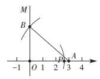

# Mathematics - 题目 3614

**ID**: c2a5f7deffe740608dce2864fdd2650c
**年级**: Grade 9
**难度**: Easy
**题型**: Fill-in-the-blank

## 题目
在数轴上画出表示无理数的点的方法：如图，点O为数轴上的原点，作射线OM垂直于数轴，以点A(点A对应有理数3)为圆心，4个单位长度为半径画弧交射线OM于点B，再以点O为圆心，OB的长为半径画弧交数轴于点P，则点P对应的实数是．​​​​​​​‌

## 解答

1. 由题意知， $OP=OB$ ， $AB=4$ ， $OA=3$ ，
2. 由勾股定理知， $OP=OB=\sqrt {AB{^{2}}-OA{^{2}}}=\sqrt {4{^{2}}-3{^{2}}}=\sqrt {7}$ ，
3. 故答案为： $\sqrt {7}$ ．

## 知识点

**中文**:
  - 勾股定理
  - 实数与数轴

**English**:
  - Pythagorean Theorem
  - Real Numbers and Number Line

---
