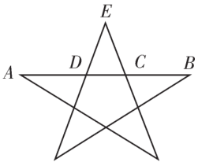

# Mathematics - 题目 2224

**ID**: cff948124eba4daca98e49d2298e2390
**年级**: Grade 9
**难度**: Easy
**题型**: Fill-in-the-blank

## 题目
两千多年前，古希腊数学家欧多克索斯发现了黄金分割，即：点P是线段 $AB$ 上一点 $\left ({AP>BP}\right )$ ，若满足 $BP:AP=AP:AB$ ，则称点P是 $AB$ 的黄金分割点．如图所示的五角星中， $AD=BC$ ，且C，D两点都是AB的黄金分割点，若 $CD=1$ ，则 $AB$ 的长是．​​​​​​​‌

## 解答

1. 解：根据题意得： $AP{^{2}}=BP\cdot AB$  $\left ({AP>BP}\right )$
2. ∵C点是 $AB$ 的黄金分割点，
3. ∴ $AC{^{2}}=BC\cdot AB$  $\left ({AC>BC}\right )$ ,
4. 即 ${\left({AD+DC}\right)^{2}}=BC\cdot \left ({AD+DC+BC}\right )$ ，
5. ∵ $AD=BC$ ，
6. ∴设 $AD=BC=x$ ，则 $AB=2x+1$ ，
7. ∴ ${\left({x+1}\right)^{2}}=x\left ({2x+1}\right )$ ，
8. 整理得： $x{^{2}}-x-1=0$ ，
9. 解得： $x=\frac {-b\pm \sqrt {b{^{2}}-4ac}}{2a}=\frac {1\pm \sqrt {5}}{2}$ ,
10. ∴ $x{{}_{1}}=\frac {1+\sqrt {5}}{2}$ ， $x{{}_{2}}=\frac {1-\sqrt {5}}{2}<0$ （舍去）．
11. ∴ $AB=2x+1=2\left ({\frac {1+\sqrt {5}}{2}}\right )+1=2+\sqrt {5}$ .
12. 故此题答案为： $2+\sqrt {5}$ ．

## 知识点

**中文**:
  - 公式法解一元二次方程
  - 黄金分割

**English**:
  - Solving by Quadratic Formula
  - Golden Ratio

---
