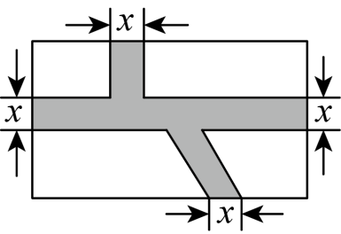

# Mathematics - 题目 1918

**ID**: e559f547867b4db49a4402471a456079
**年级**: Grade 9
**难度**: Easy
**题型**: Fill-in-the-blank

## 题目
如图，在长为28米，宽为10米的矩形空地上修建如图所示的道路（图中的阴影部分），余下部分铺设草坪，要使得草坪的面积为243平方米，设道路的宽为x米，则 $x=$．​​​​​​​‌

## 解答

1. 解：依题意， $\because $ 道路的宽为 $x$ 米，
2. $\therefore $ 铺设草坪的面积等于长为 $(28-x)$ 米、宽 $(10-x)$ 米的矩形面积．
3. $\because $ 草坪的面积为243平方米，
4. $\therefore (28-x)(10-x)=243$ ．
5. ∴ $x{^{2}}-38x+37=0$ ．
6. $\left ({x-37}\right )\left ({x-1}\right )=0$
7. ∴ $x{{}_{1}}=1，x{{}_{2}}=37>10$ （舍去）

## 知识点

**中文**:
  - 几何问题

**English**:
  - Geometry Problems

---
