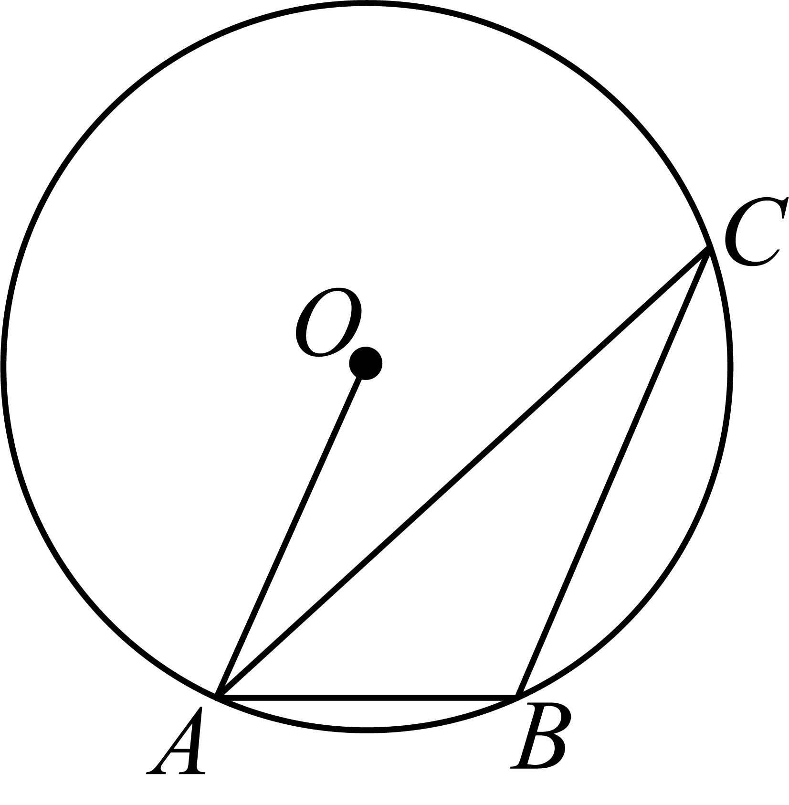

# Mathematics - 题目 3928

**ID**: ef8e45624e6f493aa6317b05b263d6e4
**年级**: Grade 9
**难度**: Easy
**题型**: Fill-in-the-blank

## 题目
如图 ${\rm ，}\vartriangle ABC$ 是 $\odot O$ 的内接三角形，若 $OA{\rm{/\mskip-4mu/}}CB{\rm ，}$  $\angle ACB=25{}^\circ {\rm ，}$ 则 $\angle CAB=$．​​​​​​​‌

## 解答

1. 解∶连接 $OB{\rm ，}$
2. 
3. ∵ $\angle ACB=25{}^\circ {\rm ，}$
4. ∴ $\angle AOB=2\angle ACB=50{}^\circ {\rm ，}$
5. ∵ $OA=OB{\rm ，}$
6. ∴ $\angle OAB=\angle OBA=\frac {1}{2}\left ({180{}^\circ -\angle AOB}\right )=65{}^\circ {\rm ，}$
7. ∵ $OA{\rm{/\mskip-4mu/}}CB{\rm ，}$
8. ∴ $\angle OAC=\angle ACB=25{}^\circ {\rm ，}$
9. ∴ $\angle CAB=\angle OAB-\angle OAC=40{}^\circ $ ．

## 知识点

**中文**:
  - 圆周角定理及推论

**English**:
  - Inscribed Angle Theorem

---
