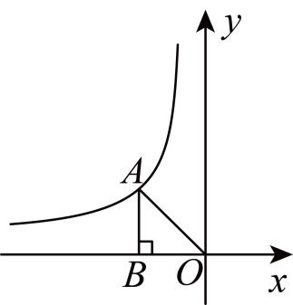

# Mathematics - 题目 683

**ID**: f18559eaacea4b34bc2e9dc8fb5736f1
**年级**: Grade 9
**难度**: Easy
**题型**: Fill-in-the-blank

## 题目
如图，点 $\mathrm{A}$ 是反比例函数 $y=\frac {k}{x}(k<0)$ 图象上的一点，过点 $\mathrm{A}$ 作 $AB⊥x$ 轴于点 $B$ ， $\vartriangle ABO$ 的面积为3，则 $k$ 的值为．​​​​​​​‌

## 解答

1. 解：由题意得： $S{{}_{\vartriangle ABO}}=\frac {\left |{k}\right |}{2}=3$ ，
2. $\therefore \left |{k}\right |=6$ ，
3. $\because $ 反比例函数的图象在第二象限，
4. $\therefore k<0$ ，
5. $\therefore k=-6$

## 知识点

**中文**:
  - 反比例函数系数k的几何意义及应用

**English**:
  - Geometric Meaning and Application of Coefficient k

---
