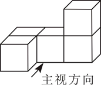

# Mathematics - 题目 345

**ID**: 0aae69f624954565abcc41b025ea8bb0
**年级**: Grade 9
**难度**: Easy
**题型**: Multiple-choice

## 题目
如图是由5个完全相同的小正方体组成的几何体，则该几何体的左视图是（      ）​​​​​​​‌

## 解答

1. 解：这个几何体的左视图是
2. ，
3. 故选：A．

## 知识点

**中文**:
  - 判断几何体的三视图

**English**:
  - Determining Three Views

---
