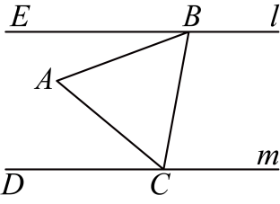

# Mathematics - 题目 3506

**ID**: 0bc4b4acb4234a72bc9f5c698728c44a
**年级**: Grade 9
**难度**: Easy
**题型**: Multiple-choice

## 题目
如图，直线 $l\parallel m$ ，等边三角形 $ABC$ 的两个顶点 $B$ ， $C$ 分别落在直线 $l,\,m$ 上，若 $\angle ABE=23{}\degree $ ，则 $\angle ACD$ 的度数是（      ）​​​​​​​‌

## 解答

1. 解：∵ $l{\rm{/\mskip-4mu/}}m$ ，
2. ∴ $\angle EBC+\angle DCB=180{}\degree $ ，
3. 即 $\angle EBA+\angle ABC+\angle ACB+\angle ACD\mathrm{=}180{}\degree $ ，
4. ∵ $\vartriangle ABC$ 是等边三角形，
5. ∴ $\angle ABC=\angle ACB=60{}\degree $ ，
6. 又∵ $\angle ABE=23{}\degree $ ，
7. ∴ $23{}\degree +60{}\degree +60{}\degree +\angle ACD\mathrm{=}180{}\degree $ ，
8. ∴ $\angle ACD=37{}\degree $ ，
9. 故此题答案为B．

## 知识点

**中文**:
  - 两直线平行同旁内角互补
  - 等边三角形的性质

**English**:
  - Parallel Lines have Supplementary Consecutive Angles
  - Properties of Equilateral Triangles

---
