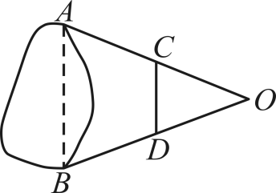

# Mathematics - 题目 2979

**ID**: 19d79d021f5c4eebbaaf8802aa44d17a
**年级**: Grade 9
**难度**: Easy
**题型**: Multiple-choice

## 题目
如图，为测量位于一水塘旁的两点 $\mathrm{A}$ ， $B$ 间的距离，在地面上确定点 $O$ ，分别取 $OA$ ， $OB$ 的中点 $C$ ， $D$ ，量得 $CD=6$ ，则 $\mathrm{A}$ ， $B$ 之间的距离是（      ）​​​​​​​‌

## 解答

1. 解：∵ $C$ ， $D$ 分别是 $OA$ ， $OB$ 的中点，
2. ∴ $CD$ 是 $\vartriangle ABC$ 的中位线，
3. ∴ $AB=2CD=2\times 6=12$ ，
4. ∴ $\mathrm{A}$ ， $B$ 之间的距离是 $12$ ，
5. 故此题答案为 ${\rm{D}}$ ．

## 知识点

**中文**:
  - 三角形中位线

**English**:
  - Triangle Midsegment

---
