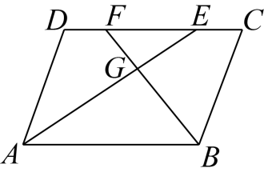

# Mathematics - 题目 1345

**ID**: 353a7e59dcb9475b9e1e9a47dba64b5a
**年级**: Grade 9
**难度**: Easy
**题型**: Multiple-choice

## 题目
如图，四边形 $ABCD$ 为平行四边形， $CE:EF:FD=1:2:1$ ， $AE$ ， $BF$ 相交于点 $G$ ．设 $\vartriangle EFG$ 和 $\vartriangle ABG$ 的面积分别为 $S{{}_{\vartriangle EFG}}$ ， $S{{}_{\vartriangle ABG}}$ ，则 $S{{}_{△EFG}}:S{{}_{△ABG}}=$ （      ）​​​​​​​‌

## 解答

1. 解： $\because $ 四边形 $ABCD$ 为平行四边形，
2. $\therefore CD//AB$  ，
3. $\therefore \vartriangle EFG\sim \vartriangle ABG$  ，
4. $\because CE:EF:FD=1:2:1$ ，
5. $\therefore \frac {EF}{AB}=\frac {2}{1+1+2}=\frac {2}{4}=\frac {1}{2}$ ，
6. $\therefore S{{}_{△EFG}}:S{{}_{△ABG}}={\left({\frac {EF}{AB}}\right)^{2}}=\frac {1}{4}$ ．
7. 故选：D．

## 知识点

**中文**:
  - 相似三角形的判定与性质综合

**English**:
  - Determination and Properties

---
