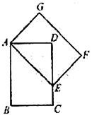

# Mathematics - 题目 798

**ID**: 37ff10667839459cabccbbf721283e5f
**年级**: Grade 9
**难度**: Easy
**题型**: Multiple-choice

## 题目
如图，在矩形 $ABCD$ 中， $AD=5$ ，将矩形 $ABCD$ 绕点 $A$ 逆时针旋转得到矩形 $AEFG$ ，点 $B$ 的对应点 $E$ 落在 $CD$ 上，且 $DE=EF$ ，则 $AB$ 的长为（      ）​​​​​​​‌

## 解答

1. ∵两矩形是旋转得到；
2. ∴EF=AD=5；
3. ∵DE=EF，
4. ∴DE=5，
5. ∴AE= $\sqrt {AD{^{2}}+ED{^{2}}}=\sqrt {5{^{2}}+5{^{2}}}=5\sqrt {2}$ ，
6. ∴AB=AE= $5\sqrt {2}$ ，故选A.

## 知识点

**中文**:
  - 几何变换——旋转综合题

**English**:
  - Rotation Comprehensive Problems

---
