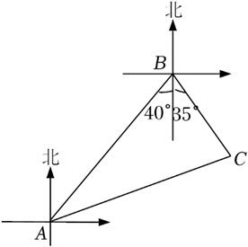

# Mathematics - 题目 3128

**ID**: 3a2978b48f2c485a8078bbf0c711e5ed
**年级**: Grade 9
**难度**: Easy
**题型**: Multiple-choice

## 题目
如图，某海域中有A，B，C三个小岛，其中A在B的南偏西40°方向，C在B的南偏东35°方向，且B，C到A的距离相等，则小岛C相对于小岛A的方向是（      ）​​​​​​​‌

## 解答

1. 解：如图：由题意得：
2. ∠ABC＝∠ABE+∠CBE＝40°+35°＝75°，AD∥BE，AB＝AC，
3. ∴∠ABC＝∠C＝75°，
4. ∴∠BAC＝180°﹣∠ABC﹣∠C＝30°，
5. ∵AD∥BE，
6. ∴∠DAB＝∠ABE＝40°，
7. ∴∠DAC＝∠DAB+∠BAC＝40°+30°＝70°，
8. ∴小岛C相对于小岛A的方向是北偏东70°，
9. 故选：A．
10. ．

## 知识点

**中文**:
  - 方位角
  - 等腰三角形的性质

**English**:
  - Azimuth / Bearing
  - Properties of Isosceles Triangles

---
