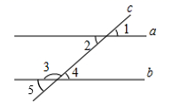

# Mathematics - 题目 2644

**ID**: 3cc001184f8246eca0e586efb358623b
**年级**: Grade 9
**难度**: Easy
**题型**: Multiple-choice

## 题目
如图，直线 $a$ 、 $b$ 被直线 $c$ 所截，下列条件能判断 $\bm{a}{\rm{/}}{\rm{/}}\bm{b}$ 的是（      ）​​​​​​​‌

## 解答

1. 解：A.  $\angle 1$ 与 $\angle 2$ 是对顶角，对顶角相等不能判断两直线平行，故此选项不符合题意；
2. B.  $\angle 1=\angle 4$ ，根据同位角相等能判断两直线平行，故此选项符合题意；
3. C.  $\angle 3$ 与 $\angle 4$ 是邻补角，不能判断两直线平行，故此选项不符合题意；
4. D.  $\angle 3$ 与 $\angle 5$ 是邻补角，不能判断两直线平行，故此选项不符合题意；
5. 故选：B．

## 知识点

**中文**:
  - 同位角相等两直线平行

**English**:
  - Parallel if Corresponding Angles Equal

---
