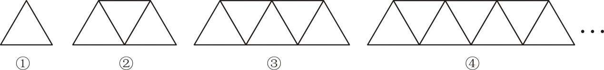

# Mathematics - 题目 3467

**ID**: 3f23174df5cf4d2db21bd16d1a3fbce2
**年级**: Grade 9
**难度**: Easy
**题型**: Multiple-choice

## 题目
用三角形按如图所示的规律拼图案，其中第①个图案中有1个三角形，第②个图案中有3个三角形，第③个图案中有5个三角形，．．．，按此规律排列下去，则第⑦个图案中三角形的个数是（      ）​​​​​​​‌

## 解答

1. 解：∵第①个图案中有 $2\times 1-1=1$ 个三角形，
2. 第②个图案中有 $2\times 2-1=3$ 个三角形，
3. 第③个图案中有 $2\times 3-1=5$ 个三角形,
4. ……
5. ∴第 $n$ 个图形中三角形的个数为 $(2n-1)$ 个，
6. ∴第⑦个图案中三角形的个数是 $2\times 7-1=13$ ，
7. 故选B．

## 知识点

**中文**:
  - 规律型：图形的变化类

**English**:
  - Patterns: Geometric Variations

---
