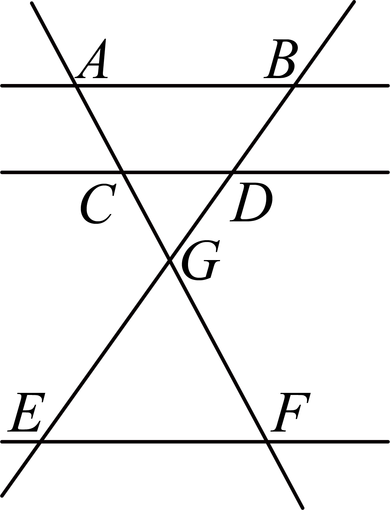

# Mathematics - 题目 800

**ID**: 40bbbe40cae949459303ba4416f2e416
**年级**: Grade 9
**难度**: Easy
**题型**: Multiple-choice

## 题目
如图， $AB{\rm{/\mskip-4mu/}}CD{\rm{/\mskip-4mu/}}EF$ ， $AF$ 交 $BE$ 于点 $G$ ，若 $AC=CG,AG=FG$ ，则下列结论错误的是（      ）​​​​​​​‌

## 解答

1. 解： $\because AC=CG,AG=FG$ ，
2. $\therefore FG=AG=2AC=2CG$ ， $CF=3AC=3CG$ ， $AF=4AC=4CG$ ，
3. $\therefore \frac {CG}{CF}=\frac {1}{3}$ ，故D选项正确；
4. $\because AB{\rm{/\mskip-4mu/}}CD{\rm{/\mskip-4mu/}}EF$ ，
5. $\therefore \frac {DG}{BG}=\frac {CG}{AG}=\frac {1}{2}$ ， $\frac {BG}{EG}=\frac {AG}{FG}=1$ ， $\frac {CD}{EF}=\frac {CG}{FG}=\frac {1}{2}$ ，故A、C选项正确，
6. $\therefore \frac {DG}{BE}=\frac {CG}{AF}=\frac {1}{4}$ ，故B选项结论错误，
7. 故选B．

## 知识点

**中文**:
  - 平行线分线段成比例定理

**English**:
  - Parallel Lines Intercept Theorem

---
