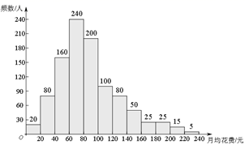

# Mathematics - 题目 2001

**ID**: 41c4f154d9a94955b84d4fb0bfa22232
**年级**: Grade 9
**难度**: Easy
**题型**: Multiple-choice

## 题目
为了了解2018年北京市乘坐地铁的每个人的月均花费情况，相关部门随机调查了1000人乘坐地铁的月均花费(单位：元)，绘制了如下频数分布直方图.​​​​​​​‌根据图中信息，下面3个推断中，合理的是.①小明乘坐地铁的月均花费是75元，那么在所调查的1000人中至少有一半的人月均花费超过小明；②估计平均每人乘坐地铁的月均花费的范围是60～120元；③如果规定消费达到一定数额可以享受折扣优惠，并且享受折扣优惠的人数控制在20%左右，那么乘坐地铁的月均花费达到120元的人可享受折扣.

## 解答

1. 解：①月均花费超过80元的有200+100+80+50+25+25+15+5=500人，小明乘坐地铁的月均花费是75元，∴所调查的1000人中至少有一半以上的人月均花费超过小明；故①正确；
2. ②根据图中信息，可得大多数人乘坐地铁的月均花费在60-120之间，估计平均每人乘坐地铁的月均花费的范围是60-120；故②正确；
3. ③∵1000×20%=200，而80+50+25+25+15+5=00，∴乘坐地铁的月均花费达到120元的人可享受折扣,③正确；故选D．

## 知识点

**中文**:
  - 频数分布直方图

**English**:
  - Frequency Histograms

---
