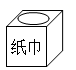

# Mathematics - 题目 2465

**ID**: 4fa0a54ac1ed4065b5a147e51a8f14de
**年级**: Grade 9
**难度**: Easy
**题型**: Multiple-choice

## 题目
如图，有一个正方体的纸巾盒，它的平面展开图是（      ）​​​​​​​‌

## 解答

1. 观察图形可知，一个正方体纸巾盒，它的平面展开图是
2. 故选：B．

## 知识点

**中文**:
  - 几何体的展开图

**English**:
  - Nets of Geometric Solids

---
