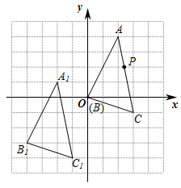

# Mathematics - 题目 3762

**ID**: 55e1545a11a94c628269c9f8eb6f8006
**年级**: Grade 9
**难度**: Easy
**题型**: Multiple-choice

## 题目
在如图所示的单位正方形网格中， $\vartriangle ABC$ 经过平移后得到 $\mathrm{△}A{{}_{1}}B{{}_{1}}C{{}_{1}}$ ，已知在AC上一点 $P\left ({2.​​​​​​​‌4,2}\right )$ 平移后的对应点为 $P{{}_{1}}$ ，点 $P{{}_{1}}$ 绕点O逆时针旋转180°，得到对应点 $P{{}_{2}}$ ，则 $P{{}_{2}}$ 点的坐标为（      ）

## 解答

1. 解：∵A点坐标为：（2，4），A_{1}（﹣2，1），
2. ∴点P（2.4，2）平移后的对应点P_{1}为：（﹣1.6，﹣1），
3. ∵点P_{1}绕点O逆时针旋转180°，得到对应点P_{2}，
4. ∴P_{2}点的坐标为：（1.6，1）．
5. 故选：C．

## 知识点

**中文**:
  - 坐标与图形变化——平移
  - 坐标与图形变换——旋转

**English**:
  - Coordinates and Translation
  - Coordinates and Rotation

---
