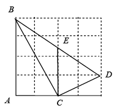

# Mathematics - 题目 3824

**ID**: 6576337e59e84648b91204a0ee76f3e9
**年级**: Grade 9
**难度**: Easy
**题型**: Multiple-choice

## 题目
如图，在 $4\times 4$ 的正方形网格中，每个小正方形的边长都为1， $E$ 为 $BD$ 与正方形网格线的交点，下列结论正确的是（      ）​​​​​​​‌

## 解答

1. 解：∵每个小正方形的边长都为1，
2. ∴ $AB=4,AC=2,BC=2\sqrt {5},CD=\sqrt {5},BD=5$ ，
3. ∴ $BC{^{2}}+CD{^{2}}=25=BD{^{2}}$ ， $AC\ne CD$ ，故C错误；
4. ∴△BCD是直角三角形，
5. ∴ $\angle BCD=\angle BAC=90{}^\circ $ ，
6. ∵ $\frac {AB}{BC}=\frac {AC}{CD}=\frac {2\sqrt {5}}{5}$ ，
7. ∴ $\mathrm{△}ABC\mathrm{∽}\mathrm{△}CBD$ ，故B错误；
8. ∴ $\angle ABC=\angle CBD$ ，故D正确；
9. ∵ $E$ 为 $BD$ 与正方形网格线的交点，
10. ∴CE∥AB，
11. ∴ $\angle ABC=\angle BCE=\angle CBD$ ，
12. ∴ $\angle DBC+\angle BDC=\angle BCE+\angle ECD=90{}^\circ $ ，
13. ∴ $\angle BDC=\angle ECD$ ，
14. ∴ $BE=CE=ED=\frac {1}{2}BD$ ，故A错误；
15. 故选D．

## 知识点

**中文**:
  - 勾股定理的逆定理
  - 直角三角形斜边上的中线
  - 相似三角形的判定与性质综合

**English**:
  - Converse of Pythagorean Theorem
  - Median to Hypotenuse of Right Triangle
  - Determination and Properties

---
