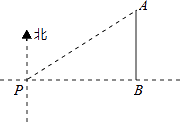

# Mathematics - 题目 3793

**ID**: 6adf37a9286a4841836ace5b7c5467cc
**年级**: Grade 9
**难度**: Easy
**题型**: Multiple-choice

## 题目
如图，一艘海轮位于灯塔P的北偏东55°方向，距离灯塔2海里的点A处，如果海轮沿正南方向航行到灯塔的正东方向，海轮航行的距离AB长是（      ）​​​​​​​‌

## 解答

1. 试题分析：首先由方向角的定义及已知条件得出∠NPA=55°，AP=2海里，∠ABP=90°，再由AB∥NP，根据平行线的性质得出∠A=∠NPA=55°．然后解Rt△ABP，得出AB=AP•cos∠A=2cos55°海里．
2. 解：如图，由题意可知∠NPA=55°，AP=2海里，∠ABP=90°．
3. ∵AB∥NP，
4. ∴∠A=∠NPA=55°．
5. 在Rt△ABP中，∵∠ABP=90°，∠A=55°，AP=2海里，
6. ∴AB=AP•cos∠A=2cos55°海里．
7. 故选C．
8. 
9. 考点：解直角三角形的应用-方向角问题．

## 知识点

**中文**:
  - 解直角三角形的实际应用

**English**:
  - Applications of Solving Right Triangles

---
